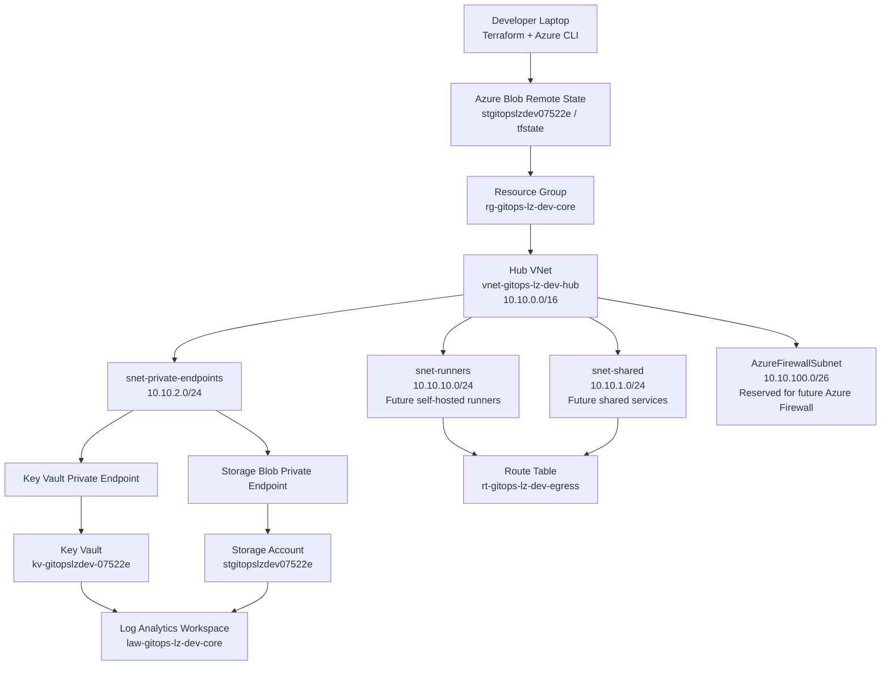
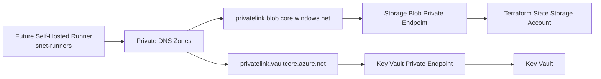
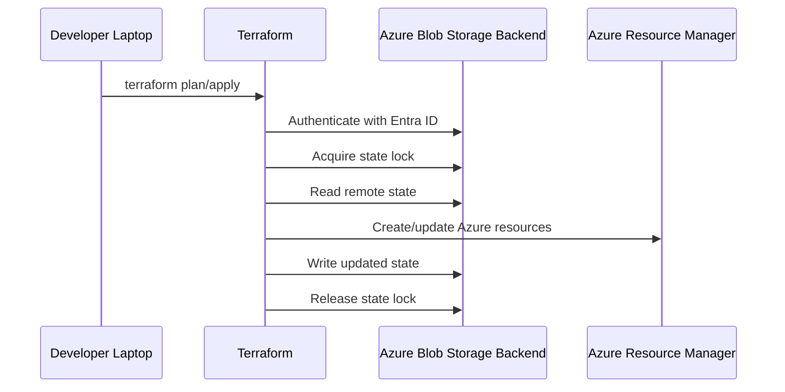
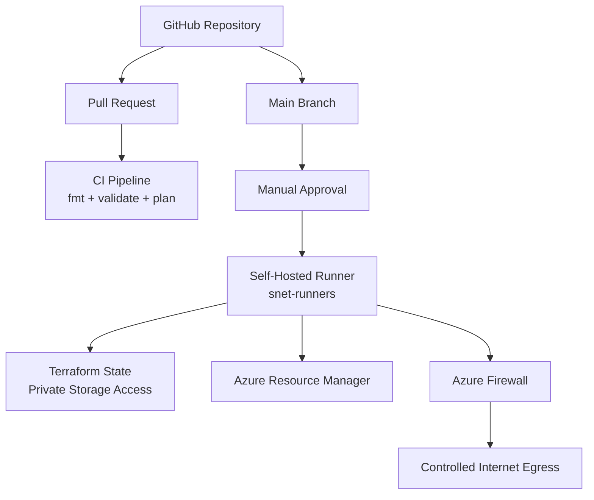

# Architecture

## Overview

This project deploys a hub-style Azure landing zone foundation for the `dev` environment.

The current architecture focuses on:

* Modular Terraform structure
* Remote Terraform state in Azure Blob Storage
* Entra ID and RBAC-based backend authentication
* Private Endpoints and Private DNS
* Subnet segmentation
* NSG baseline rules
* Route table foundation for future forced egress
* Central diagnostics through Log Analytics

---

## High-Level Architecture



---

## Network Layout

| Component                |             CIDR | Purpose                            |
| ------------------------ | ---------------: | ---------------------------------- |
| Hub VNet                 |   `10.10.0.0/16` | Main landing zone network          |
| `snet-runners`           |  `10.10.10.0/24` | Future self-hosted CI/CD runners   |
| `snet-shared`            |   `10.10.1.0/24` | Future shared services             |
| `snet-private-endpoints` |   `10.10.2.0/24` | Private Endpoint NICs              |
| `AzureFirewallSubnet`    | `10.10.100.0/26` | Reserved for future Azure Firewall |

---

## Private Access Flow



Current state:

* Private Endpoints already exist for Key Vault and Storage Blob.
* Private DNS zones are linked to the hub VNet.
* The Storage Account still has public network access enabled because Terraform currently runs from the developer laptop.
* After a self-hosted runner is deployed inside `snet-runners`, Terraform can run privately from inside the VNet.

---

## Terraform State Flow



The backend uses:

```hcl
use_azuread_auth = true
```

This means Terraform reads, writes, and locks the state blob using Entra ID authentication and Azure RBAC.

---

## Security Decisions

| Area                    | Decision                                            |
| ----------------------- | --------------------------------------------------- |
| Terraform state         | Stored remotely in Azure Blob Storage               |
| Backend authentication  | Entra ID + RBAC                                     |
| State access role       | Storage Blob Data Contributor                       |
| Key Vault access        | RBAC authorization enabled                          |
| Key Vault public access | Disabled                                            |
| Storage public access   | Temporarily enabled until runner exists inside VNet |
| Private access          | Private Endpoints for Key Vault and Storage Blob    |
| DNS                     | Private DNS zones linked to hub VNet                |
| Observability           | Diagnostic settings sent to Log Analytics           |

---

## Current Limitations

The current architecture is intentionally incomplete. The following items are planned but not deployed yet:

* Self-hosted CI/CD runner
* CI/CD pipeline
* Azure Firewall
* Forced egress routing
* Disabled public access for the Terraform state Storage Account
* Azure Policy baselines
* Python validation scripts

---

## Target Future Flow



Target model:

1. Developers open pull requests.
2. CI runs `terraform fmt`, `terraform validate`, and `terraform plan`.
3. Approved merges trigger controlled `terraform apply`.
4. Terraform runs from a self-hosted runner inside the VNet.
5. The state Storage Account public network access is disabled.
6. Outbound traffic is forced through Azure Firewall.
